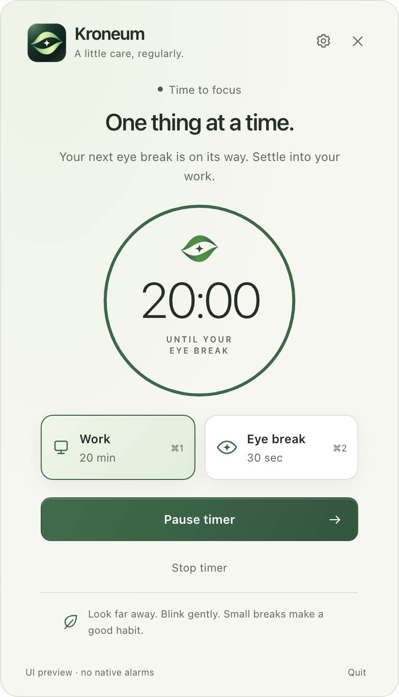
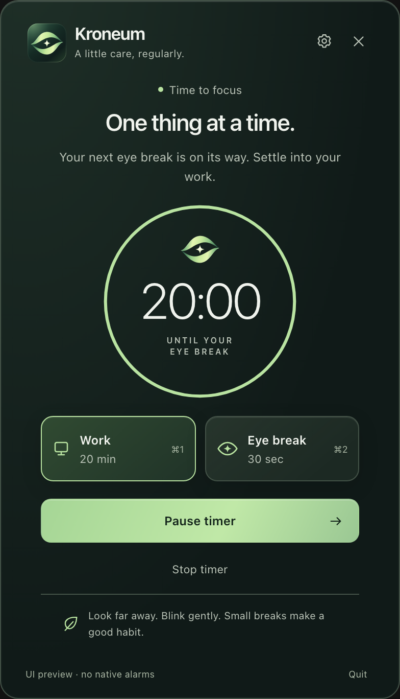

# Kroneum

A macOS menu-bar timer for regular eye breaks. Work for 20 minutes, look far away and blink for 30 seconds, then repeat.

<table align="center">
  <tr>
    <th align="center">Light</th>
    <th align="center">Dark</th>
  </tr>
  <tr>
    <td align="center"></td>
    <td align="center"></td>
  </tr>
</table>

Interface previews. The native app also shows the countdown in the macOS menu bar.

## Features

- Configurable work and eye-break timers, with a live menu-bar countdown.
- Repeating sound alerts, snooze, and an idle reminder.
- Optional screen dimming with adjustable speed and maximum level.
- Pause, resume, and optional work/break cycling after acceptance.
- Optional launch at login and automatic window hiding after timer selection.
- System light/dark appearance, keyboard controls, and reduced-motion support.

Built with Tauri 2, Rust, and TypeScript. Kroneum uses the system WebView rather than bundled Chromium.
Kroneum needs no account and sends no analytics or network requests at runtime.

## Use

1. Click the menu-bar icon and start the work timer.
2. At the reminder, start the eye break.
3. Look at something far away and blink gently.
4. After the break, select **Back to work**.

Closing the controls leaves the timer active. **Quit** stops the app.
The [user guide](docs/usage.md) covers settings, screen dimming, and shortcuts.
Kroneum supports a break habit. It is not a medical device.

## Run from source

Requirements: macOS 12 or later, Node.js 22.12 or later, Rust 1.90 or later, and Xcode command-line tools.

```sh
git clone https://github.com/azasypkin/kroneum-app.git
cd kroneum-app
npm ci
npm run app:dev
```

## Build

```sh
npm run app:build
```

The app and disk image appear in `src-tauri/target/release/bundle/`.
Copy `Kroneum.app` to Applications. Local builds are not notarized by default.

## Documentation

- [Development and tests](docs/development.md)
- [Architecture](docs/architecture.md)
- [Native macOS checks](docs/macos-testing.md)
- [Signing and releases](docs/releasing.md)

## License

[MIT](LICENSE).
